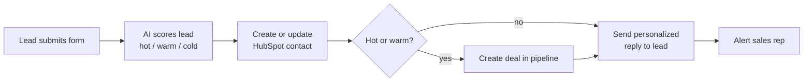

# Speed-to-Lead Automation (n8n + HubSpot + AI)

Responds to every new lead in under a minute, scores it with AI, and puts it in the right place in the CRM, so no enquiry is ever missed or forgotten.

**Live demo:** [Try the form](PASTE_YOUR_PRODUCTION_FORM_URL_HERE) | **Video walkthrough:** [Watch on Loom](PASTE_YOUR_LOOM_LINK_HERE)

> **Note:** This is a demo project built for a fictional business ("Acme Digital Agency") to showcase the workflow. It can be adapted to any business, form, or CRM.

## What it does

| Step | What happens |
|------|--------------|
| 1. Capture | A hosted form collects name, email, phone, company, request, budget and timeline |
| 2. Score | OpenAI rates the lead hot/warm/cold with a one-line reason and drafts a personalized reply |
| 3. Save | The contact is **upserted by email**, so repeat leads never create duplicates |
| 4. Route | Hot leads go to the "Qualified to Buy" stage, warm leads to "Appointment Scheduled", cold leads get no deal |
| 5. Reply | The lead gets a personalized email within seconds |
| 6. Alert | The sales rep gets an email with the full lead details and a link to the CRM record |

## Built with
n8n, HubSpot CRM API, OpenAI API, SMTP email

## Setup (about 30 minutes)

### 1. HubSpot
1. Create a free HubSpot account.
2. **Settings > Properties > Create property** (object type: Contact). Create two:
   - Label `AI Lead Score`, field type *Single-line text* (internal name `ai_lead_score`)
   - Label `AI Lead Summary`, field type *Multi-line text* (internal name `ai_lead_summary`)
3. Create an API token. In HubSpot go to **Settings > Development > Keys > Service Keys > Create service key** (some accounts show this under Settings > Integrations). If your account offers Private Apps or Legacy Apps instead, a private app token works the same way. Add these scopes:
   `crm.objects.contacts.read`, `crm.objects.contacts.write`, `crm.objects.deals.read`, `crm.objects.deals.write`
4. Copy the token (starts with `pat-`). It is shown once, so store it safely and never commit it to Git.
5. Find your **Hub ID** (portal ID): it is the number in the HubSpot URL, e.g. `app.hubspot.com/contacts/12345678/...`
6. Check that your default Sales Pipeline has the stages **Appointment Scheduled** and **Qualified To Buy**.

### 2. n8n credentials
Create these in n8n (**Credentials > Add credential**):

| Credential type | Name | Values |
|---|---|---|
| Header Auth | `OpenAI` | Name: `Authorization`, Value: `Bearer sk-...` |
| Header Auth | `HubSpot` | Name: `Authorization`, Value: `Bearer pat-...` |
| SMTP | `Email` | For Gmail: host `smtp.gmail.com`, port `465`, SSL on, your email, and an [App Password](https://myaccount.google.com/apppasswords) |

### 3. Import the workflow
1. In n8n: **Workflows > Import from file** and choose `speed-to-lead-workflow.json`.
2. Open the **Config** node and fill in: business name, your name, your email, booking link, HubSpot portal ID.
3. Attach credentials: `OpenAI` on *Score Lead with AI*, `HubSpot` on *Save Contact in HubSpot* and *Create Deal*, `Email` on both email nodes.

### 4. Test
1. Open the **Lead Form** node and click **Execute workflow**. Use the *Test URL* to submit a test lead.
2. Check: contact appears in HubSpot, deal is created (if hot/warm), you receive the lead email and the rep alert.
3. Submit the same email again and confirm that no duplicate contact is created.

### 5. Go live
Toggle the workflow to **Active** and share the **Production URL** of the form.

## Customizing for a client
- **Scoring rules:** edit the system prompt in *Score Lead with AI*
- **Pipeline stages:** change the `dealstage` values in *Create Deal*. If a client has a custom pipeline, use their stage IDs.
- **Slack instead of email:** replace *Alert Sales Rep* with a Slack node
- **Different CRM:** swap the two HubSpot HTTP nodes for GoHighLevel API calls
- **Different form source:** replace *Lead Form* with a webhook from Typeform, Facebook Lead Ads, a website form, etc.
- **Add SMS:** add a Twilio node after *Email the Lead*

## Screenshots
| | |
|---|---|
| n8n workflow |  |
| Lead form |  |
| HubSpot contact with AI score |  |
| Deal in pipeline |  |
| Reply email to lead |  |

## Reliability and safety
- If the AI returns invalid output, the lead defaults to "warm" and a generic reply is sent, so no lead is ever dropped
- Form text is treated strictly as data in the prompt (basic prompt-injection protection)
- No credentials are stored in this repo. They live in n8n credentials.

## Troubleshooting
| Problem | Likely cause |
|---|---|
| HubSpot returns 400 about a property | The two custom properties are missing or have a different internal name |
| HubSpot returns 401/403 | Wrong token, or a missing scope on the private app |
| Deal creation fails | Your pipeline uses different stage IDs than the default |
| Emails not sending | Gmail needs an App Password (2-step verification must be on) |
| Form URL doesn't work | The workflow isn't active (use the Test URL while testing) |
